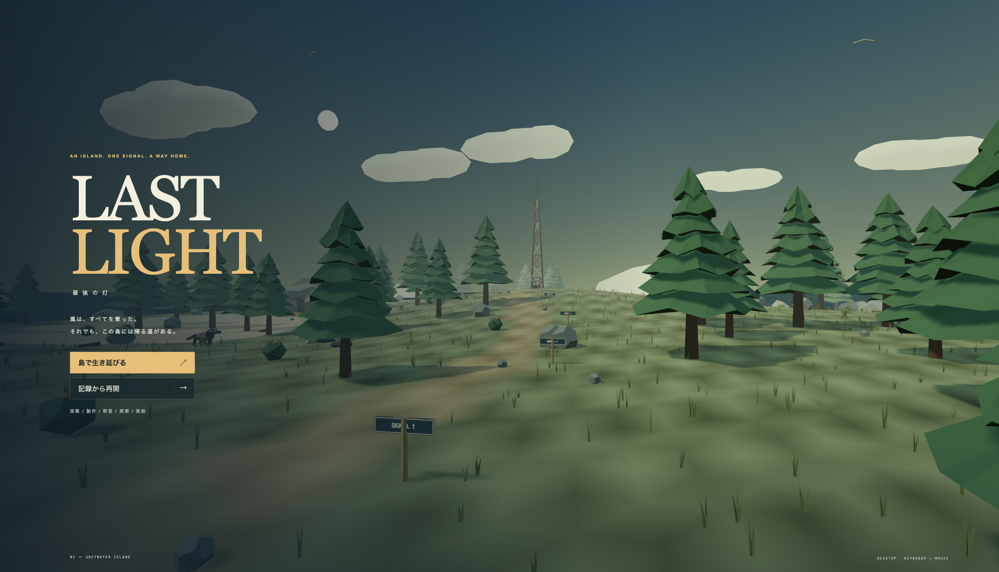
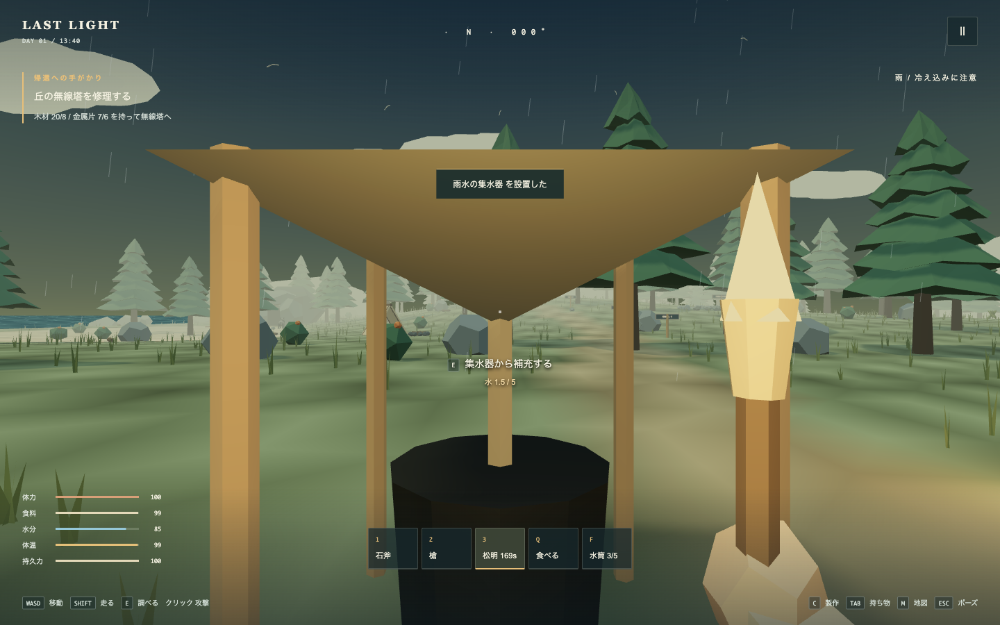
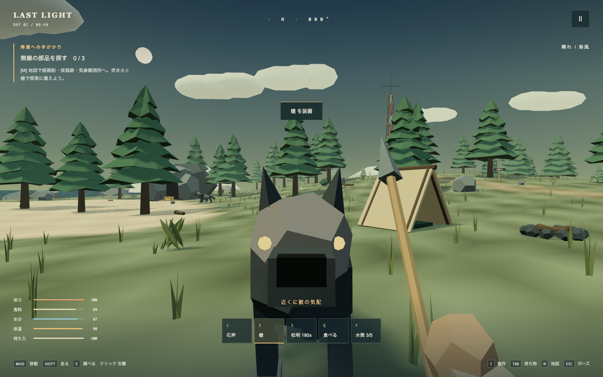
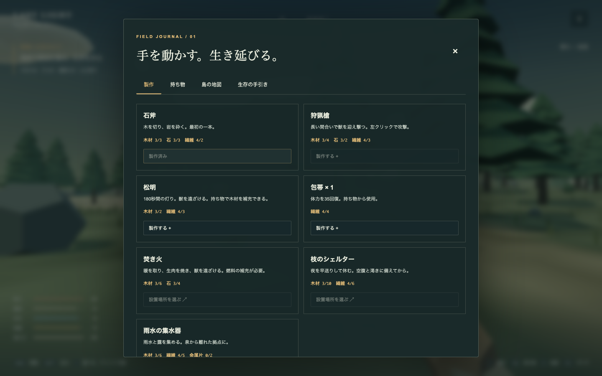
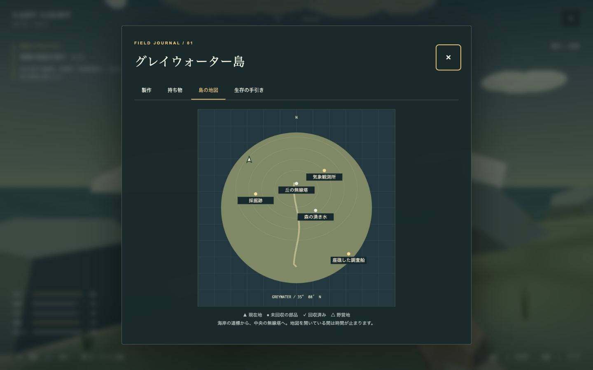

# LAST LIGHT — 最後の灯

<p align="center">
  
</p>

<p align="center">
  <strong>An original first-person 3D browser survival game. 100% procedural, offline-first, zero external asset dependencies.</strong><br>
  <strong>孤島で採集・製作・野営をしながら、3つの無線部品を回収して救助を呼ぶ完全コード生成のブラウザ3Dサバイバルゲーム。</strong>
</p>

<p align="center">
  <a href="#license"></a>
  =20.0.0">
  
  
  
  
</p>

---

## 目次 / Table of Contents

- [ゲーム概要 / Overview](#ゲーム概要--overview)
- [特徴 / Key Features](#特徴--key-features)
- [操作方法 / Controls](#操作方法--controls)
- [ゲームの進め方 / Gameplay Guide](#ゲームの進め方--gameplay-guide)
- [動作環境 / System Requirements](#動作環境--system-requirements)
- [起動方法 / Quickstart](#起動方法--quickstart)
- [プロジェクト構成 / Architecture](#プロジェクト構成--architecture)
- [プライバシーとセキュリティ / Privacy & Security](#プライバシーとセキュリティ--privacy--security)
- [ライセンス / License](#ライセンス--license)

---

## ゲーム概要 / Overview

**LAST LIGHT（最後の灯）** は、WebGL（Three.js）と Web Audio API を活用した、デスクトップブラウザ向けの一人称視点3Dサバイバルゲームです。

嵐によって船から投げ出された調査員ミオは、かつて気象観測に使われていた孤島「グレイウォーター島」に漂着します。生き延びるために海岸の漂流物から道具を作り、暖を取り、食料と水を確保しながら、島に残された3つの無線部品を回収して丘の無線塔から救助信号を届けることが目標です。

### 英語概要 / English Summary

> **LAST LIGHT** is an original desktop browser first-person 3D survival game built with Three.js and the native Web Audio API. Stranded on the mysterious Greywater Island after a shipwreck, you play as field researcher Mio. Gather raw materials, craft essential survival tools (stone axe, spear, torch), build camp structures, manage hunger, thirst, warmth, and stamina, defend against pack wolves, and uncover field notes left by the former island keepers to restore the radio mast and signal for rescue.
>
> **Core Architectural Principle**: The game requires **zero external binary assets** (no downloaded `.gltf`/`.obj` 3D models, no static image textures, no audio files). All 3D geometry, articulation hierarchies, skybox gradients, and soundscapes are synthesized entirely via procedural code in real time.

---

## 特徴 / Key Features

<p align="center">
  
  
</p>

1. **完全プロシージャル生成（Zero External Asset Dependencies）**
   - すべての3D形状（地形・木々・大岩・漂着船・観測所・灯台・無線塔・プレイヤーの腕と武器・狼の骨格関節）はコードによって動的に組み立てられます。
   - すべての音響（波の音・雨・風・足音・打撃・採取・狼の唸り・心音）は Web Audio API のシンセサイザー合成によってリアルタイム生成されます。
2. **本格的なサバイバルループ**
   - 体力、食料、水分、体温、持久力の5つの生命維持ステータス。
   - 昼夜サイクルと天候（晴れ・夜の冷え込み・雨）。
   - 雨水の集水器や湧き水による給水、焚き火による調理と暖房、シェルターでの安全な休息。
3. **緊張感のある近接戦闘と野生動物AI**
   - 狼は群れで行動し、威嚇の予兆動作、方向を定めた踏み込み（突進）、隙の露出を行います。
   - 横ステップや後退で躱し、狩猟槍の両手突きで迎撃するアクション性。松明や焚き火による獣避けも有効。
4. **手帳と物語（Field Journal & Lore）**
   - 5章からなるメインクエストと、3つのサイドストーリー（北岬の灯台復旧、拠点設営、失われた記録の回収）。
   - 島で暮らしていた人々（船長レン、整備士ソウ、観測員ナギ、灯台守エダ）が残した手紙と記録。
5. **親切な製作案内（Smart Crafting & Guidance）**
   - 作業台は不要。手帳を開けば必要な素材の見た目・採集方法・不足数を図解で確認可能。
   - 目的の素材や探索地点への3D空間コンパス＆ウェイポイント案内。
6. **保存と復帰（Local Persistence）**
   - 20秒ごとの自動保存および手動保存。ブラウザの `localStorage` に完全にローカル保存され、リロード後もすぐに再開できます。

---

## 操作方法 / Controls

| 入力 (Key) | 動作 (Action) |
|---|---|
| **WASD** | 前後左右の移動 (Walk) |
| **Shift** | 疾走・ダッシュ (Sprint) |
| **Space** | ジャンプ (Jump) |
| **マウス (Mouse)** | 視点を動かす（マウス固定非対応環境ではドラッグまたは矢印キー） |
| **左クリック (Left Click)** | 攻撃 / 建築プレビューを設置 (Attack / Place Structure) |
| **E** | 採集・調べる・調理・燃料補給・休息 (Interact / Gather) |
| **1 / 2 / 3** | 石斧 / 狩猟槍 / 松明 を装備（未所持時は製作画面を開く） |
| **Q / F** | 食事をする（木の実・焼肉） / 水筒から飲む (Eat / Drink) |
| **C** | 製作画面を開く (Crafting Menu - No workbench needed) |
| **J** | クエスト手帳を開く (Quests & Objectives) |
| **M** | 島の地図を開く (Island Map & Waypoints) |
| **Tab** | 持ち物一覧・包帯使用・松明給油 (Inventory) |
| **H** | 生存の手引き・図鑑を開く (Survival Guide & Codex) |
| **R** | 建築物の向きを回転 (Rotate building preview) |
| **Esc** | 建築の取消 / ポーズメニュー・設定を開く (Pause / Cancel build) |

---

## ゲームの進め方 / Gameplay Guide

<p align="center">
  
  
</p>

1. **第一歩: 石斧を作る**
   - 海岸に落ちている「枝（木材）」「小石（石）」「草（繊維）」に近づいて **E** で拾います。道具は不要です。
   - 木材3・石3・繊維2が集まったら **C** を押し、「石斧を製作する」を実行します。
   - 石斧があれば、木を伐採してまとまった木材を、大岩を砕いて石を入手できるようになります。
2. **森への備え: 狩猟槍と松明**
   - 木材4・石2・繊維3で「狩猟槍」を製作。狼との戦いで間合いを取りやすくなります。
   - 木材2・繊維3で「松明」を製作。暗闇を照らし、狼を遠ざけることができます。
3. **野営地を整える: 火と水**
   - 木材6・石4で「焚き火」を設置。体温の低下を防ぎ、生肉を焼くことができます。
   - 島の中央東にある「湧き水」で水筒を満たします。拠点が離れている場合は「雨水の集水器」を作ると便利です。
4. **無線部品の回収**
   - 南東の座礁船（ノース17号）で **配線** を回収。
   - 西の採掘跡（洞窟）で **予備蓄電池** を回収。
   - 北東の気象観測所で **アンテナ** を回収。
5. **救助信号の発信と脱出**
   - 丘の無線塔へ3部品と木材8・金属片6を運び、**E** で修理します。
   - 信号発信後、救助船が到着するまでの90秒間、生き延びればクリアです。
   - *ヒント*: 西の補給所で手紙を受け取り、北岬の灯台を修復（木材6・金属片3）しておくと、救助船が素早く接近できるようになり待機時間が **60秒** に短縮されます。

---

## 動作環境 / System Requirements

- **対応OS**: macOS, Windows, Linux
- **推奨ブラウザ**: Google Chrome, Microsoft Edge, Mozilla Firefox, Apple Safari（最新のデスクトップ版）
- **入力機器**: キーボードおよびマウス（トラックパッド可）
- **グラフィックス**: WebGL 2.0 対応 GPU
- *注意*: モバイル端末・タッチ操作には対応していません。

---

## 起動方法 / Quickstart

### 開発用サーバーの起動 (Local Development)

```sh
# 依存関係のインストール
npm ci

# 開発サーバー起動（http://127.0.0.1:4186/）
npm run dev
```

ブラウザで `http://127.0.0.1:4186/` を開きます。

### プロダクションビルドとプレビュー (Production Build)

```sh
# 静的アセットのビルド（dist/ に出力）
npm run build

# ローカルHTTPサーバーでプレビュー
npm run preview -- --port 4187
```

※ `file://` プロトコルから直接 `index.html` を開くのではなく、ローカルHTTPサーバー（Vite preview や Python `http.server`、nginx など）経由で配信してください。

### テストの実行 (Automated Tests)

```sh
# Node.js 組み込みテストランナーによる単体テスト（37項目）
npm test
```

すべてのシミュレーション規則（採取・製作・衝突・狼AI・クエスト・セーブ・救助）は描画系と完全に分離されており、高速かつ決定論的に検証されます。

---

## プロジェクト構成 / Architecture

```text
last-light/
├── index.html              # ゲームのエントリーポイントHTML・UIダイアログ
├── package.json            # プロジェクト設定と依存ライブラリ (Three.js, Vite)
├── LICENSE                 # MIT License
├── THIRD_PARTY_LICENSES.md # オープンソースライセンスおよび素材権利関係の明記
├── SECURITY.md             # セキュリティポリシーと脆弱性報告方針
├── CONTRIBUTING.md         # コントリビューションガイドライン
├── CODE_OF_CONDUCT.md      # 参加者行動規範
├── .gitignore              # Git追跡除外設定
├── .github/                # GitHub Issue/PRテンプレートおよびCIワークフロー
│   ├── ISSUE_TEMPLATE/
│   │   ├── bug_report.md
│   │   └── feature_request.md
│   ├── PULL_REQUEST_TEMPLATE.md
│   └── workflows/ci.yml    # GitHub Actions CI
├── src/
│   ├── main.js             # 入力制御、HUD/手帳UI管理、ゲームループ
│   ├── simulation.js       # 生存ステータス、物理衝突、クラフト、AIシミュレーション
│   ├── world.js            # Three.js による島・天候・建築・地形の3Dプロシージャル生成
│   ├── actors.js           # 一人称の腕・武器、狼の関節構造・アニメーション
│   ├── motion.js           # 武器の軌道計算、接触判定タイミング
│   ├── content.js          # クエスト定義、島の記録・手紙、アイテム定義、インラインSVGアイコン
│   ├── journal.js          # 手帳画面（クラフト、地図、クエスト、手引き）のDOM構築
│   ├── audio.js            # Web Audio API による環境音・効果音のリアルタイム合成
│   └── style.css           # UIスタイルシート
├── tests/                  # 自動回帰テストスイート
│   ├── survival.test.js    # サバイバルロジック・クラフト・セーブのテスト
│   ├── quests.test.js      # クエスト・手帳進行・地点案内のテスト
│   ├── motion.test.js      # 攻撃軌道・接触判定・狼の予兆動作のテスト
│   └── traversal.test.js   # 衝突判定を遵守した自律踏破・救助完走テスト
└── evidence/               # 実機検証ログ・スクリーンショット
```

---

## プライバシーとセキュリティ / Privacy & Security

- **完全オフライン動作**: 初回読み込み完了後、外部サーバーへの通信は一切行われません。
- **テレメトリ・トラッキングなし**: Google Analytics などの計測ツール、Cookie、第三者トラッカーは含まれていません。
- **APIキー・認証情報なし**: バックエンドやクラウドサービスへのAPIキーやシークレットは不要です。
- **データ保存場所**: ユーザーのプレイデータは、ブラウザ内の `localStorage`（オリジン分離）にのみ保存されます。

詳細は [SECURITY.md](SECURITY.md) をご覧ください。

---

## ライセンス / License

本プロジェクトは **MIT License** の下で公開されています。商用・非商用を問わず自由にご利用・改変いただけます。

詳細は [LICENSE](LICENSE) および [THIRD_PARTY_LICENSES.md](THIRD_PARTY_LICENSES.md) をご覧ください。
